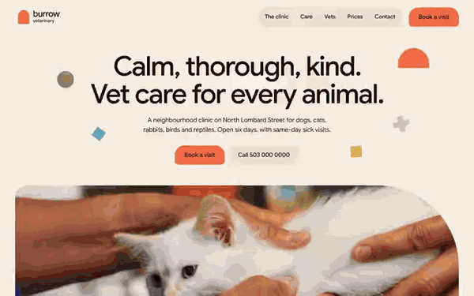

# Free HTML veterinary website template with GSAP scroll animations — Burrow

**Website for a veterinary clinic or animal hospital: a free HTML template in one file, with GSAP scroll animations, no build step, MIT license. Made by [8B](https://8b.com/), the AI website builder.**

[](LICENSE)  

**[Live demo](https://8bsite.github.io/veterinary-website-template/)** · **[Use this template](https://github.com/new?template_name=veterinary-website-template&template_owner=8bsite)** · **[Download ZIP](https://github.com/8bsite/veterinary-website-template/archive/refs/heads/main.zip)** · **[Template page on 8b.com](https://8b.com/templates/burrow/)**

<a href="https://8bsite.github.io/veterinary-website-template/"></a> <a href="https://8bsite.github.io/veterinary-website-template/"></a>

<p align="center"><a href="https://8bsite.github.io/veterinary-website-template/"></a><br><sub>Scroll animation</sub></p>

A one-page site for a neighbourhood vet clinic that sees dogs, cats, rabbits, birds and reptiles, with services, vets, prices, recent patients and a visit request form. Warm cream and dark brown with six muted accent colours; a set of flat shapes (arch, circle, diamond, plus) does the moving: the small coral arch grows into a doorway on the first scroll, colour panels are dealt out like cards and the patient cards roll past like a wheel.

Good for: veterinary clinic or animal hospital; exotic-pet or specialist vet practice; pet groomer, boarding or other pet-care business; any small local clinic with a team, services and a price list.

## Use it with an AI coding agent

Download the files into your project (in Windows PowerShell type `curl.exe`):

```bash
curl -LO https://raw.githubusercontent.com/8bsite/veterinary-website-template/main/index.html
curl -LO https://raw.githubusercontent.com/8bsite/veterinary-website-template/main/AGENTS.md
curl -LO https://raw.githubusercontent.com/8bsite/veterinary-website-template/main/LICENSE
curl -LO https://raw.githubusercontent.com/8bsite/veterinary-website-template/main/CREDITS.md
```

Then give your agent this prompt:

```text
Read AGENTS.md, then edit index.html. Use this template as the base for a veterinary clinic site for <your practice: name, town and address, which animals you see, services and prices, vets and nurses, opening hours, how to book>. Keep the layout, the motion and the single-file format; replace the brand name, copy, photos, staff, patient stories, prices, hours, links and contacts, and recolour it through the CSS variables if needed.
```

Give the agent the downloaded file, not a link: from a link it would rebuild a different page. No agent? Click **[Use this template](https://github.com/new?template_name=veterinary-website-template&template_owner=8bsite)**, edit `index.html` and turn on **Settings → Pages**.

## What's on the page

- **Navigation** — top bar: arch logo and wordmark, section links, Book a visit button; phone menu overlay
- **Calm, thorough, kind. Vet care for every animal.** — first screen: headline, two buttons, wide photo and floating shapes; second screen: four numbered steps of a visit on a coral arch
- **Two doors. Cats never wait with dogs.** — two arch-cut photos either side of the copy (demo: separate cat and dog sides of the clinic)
- **Small, scaly, feathered or furry.** — four overlapping colour panels, one per group (demo: animals the clinic treats)
- **What we do here.** — list of six services, each row with a photo, text and a short note
- **Who you’ll meet in the room.** — four people with portraits, role and one line (demo: vets and head nurse)
- **This month at Burrow.** — pinned horizontal row of seven cards (demo: patients of the month, name, breed, age, why they came)
- **Prices you see before we start.** — dark band: price list (service, what is included, price) and a note on estimates
- **On Lombard Street since 2014.** — sticky building photo beside three dated paragraphs (demo: the clinic's history)
- **Before you come in.** — questions and answers (native &lt;details&gt;)
- **Come in.** — coral arch panel: address, phone, email, hours, photo and a visit request form
- **Footer** — rounded panel: brand line, address, three link columns, copyright and the Design: 8B credit

## Design

Palette:             
Fonts: Google Sans (Google Fonts). Change both through the CSS variables in the `:root` block at the top of `<head>`.

- The coloured shapes, the arch logo mark and the coral doorway are CSS (border-radius and clip-path), not images: recolour them through the --color-* variables.
- The second screen of the opening (the four steps on the coral arch) belongs to the same section as the first screen; the arch animation measures both, so keep them together.

## Before you publish

- Replace everything marked `data-8b-placeholder` (social preview image, favicon, phone, email, map, form, social) and the invented demo facts: prices, dates, address. [AGENTS.md](AGENTS.md) lists them.
- The form sends nothing yet: connect it to Formspree or Netlify Forms, or remove it.

## Tech

GSAP 3.13.0, ScrollTrigger, SplitText, Lenis 1.3.27 from jsDelivr, 104 KB, no build step. Chrome and Edge 108+, Safari 15.4+, Firefox 101+ (it uses cascade layers, small/dynamic viewport units). With "reduce motion" on, the page is complete and still.

## License

MIT, see [LICENSE](LICENSE). Photos, fonts and libraries keep their own licences: [CREDITS.md](CREDITS.md). More free templates: [8b.com/templates](https://8b.com/templates/) · [github.com/8bsite](https://github.com/8bsite).
